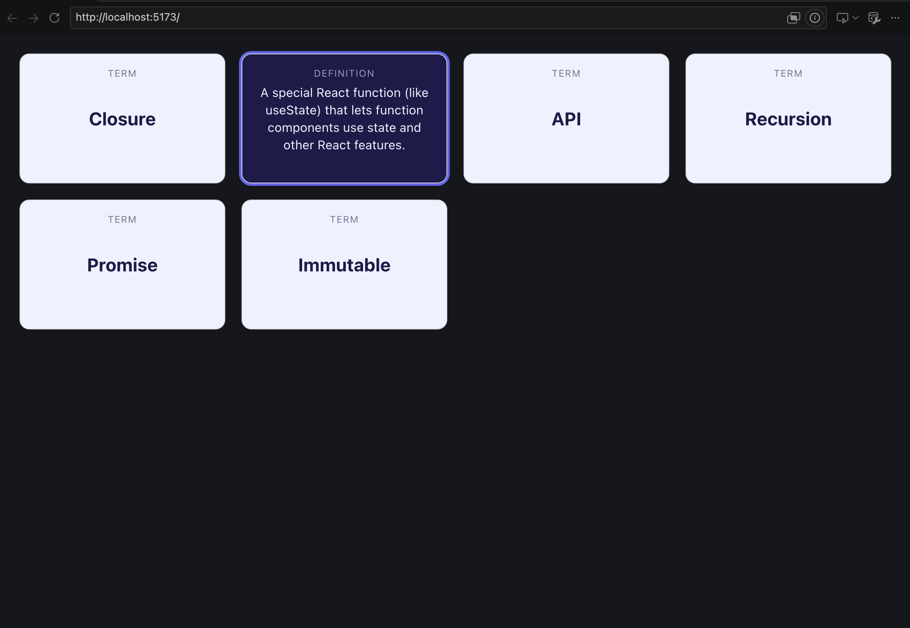

# Flashcards

A responsive React flashcard deck for revising common programming concepts. Each card displays a term on the front and reveals its definition when selected.



## Features

- Six built-in programming and React topics
- Click or tap to flip a card
- Keyboard support with `Enter` and `Space`
- Responsive grid that adapts to the available screen size
- Smooth 3D card-flipping animation
- Accessible card labels and visible keyboard focus styling

## Tech Stack

- React 19
- Vite 8
- JavaScript
- CSS

## Getting Started

### Prerequisites

- Node.js 18 or newer
- npm

### Installation

```bash
npm install
```

### Run the Development Server

```bash
npm run dev
```

Open the local URL printed by Vite, typically `http://localhost:5173`.

## Available Scripts

| Command | Description |
| --- | --- |
| `npm run dev` | Start the Vite development server |
| `npm run build` | Create a production build |
| `npm run preview` | Preview the production build locally |
| `npm run lint` | Run ESLint |

## Project Structure

```text
flashcards/
├── public/              # Static public assets
├── src/
│   ├── assets/          # Images and bundled assets
│   ├── App.jsx          # Application entry component
│   ├── FlashcardDeck.jsx # Flashcard data, component, and styles
│   ├── main.jsx         # React application bootstrap
│   └── index.css        # Global styles
├── index.html
└── package.json
```

## Customizing the Cards

Flashcards are defined in the `CARDS` array in `src/FlashcardDeck.jsx`. Add or edit entries using a term and definition:

```jsx
const CARDS = [
  {
    term: "Closure",
    definition: "A function that remembers variables from its creation scope.",
  },
];
```

## Production Build

```bash
npm run build
```

The optimized application is generated in the `dist/` directory.

